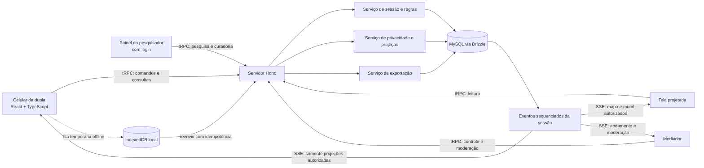
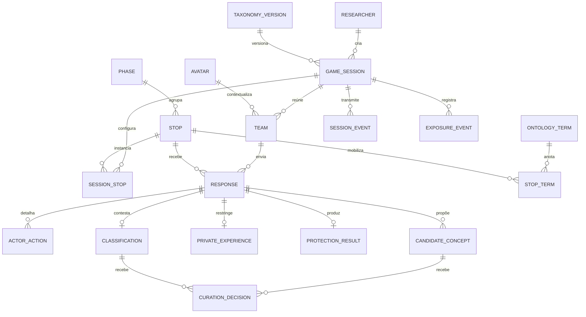

# Entre Mundos Digitais

## Etapa 1 — Arquitetura, modelo de dados e alinhamento ontológico

**Revisão:** 1.1 — inclusão do módulo de problemas de privacidade.  
**Status:** proposta para validação antes da produção de conteúdo e da implementação.  
**Escopo desta etapa:** não inclui código do jogo, casos reais nem novas classes ontológicas.

## 1. Decisões confirmadas e premissas de projeto

- Aplicação web full-stack, utilizada pela internet e com banco de dados na nuvem.
- Estudantes entram sem cadastro, por QR code ou código curto de sessão.
- O mediador usa uma credencial própria da sessão; o pesquisador usa login individual.
- A escala não foi fixada. A arquitetura não impõe limite rígido de participantes; a primeira meta de verificação será uma sessão com até 40 duplas, uma tela projetada e um mediador.
- A experiência é cooperativa: não há vencedor, ranking de avatares ou pontuação associada a identidades.
- A classificação apresentada aos estudantes é sempre a proposta vigente do pesquisador, vinculada a uma versão da taxonomia e passível de contestação.
- A OntoHate será usada como vocabulário especializado em discurso de ódio. O inventário deverá ser derivado dos arquivos OWL/Turtle efetivamente carregados, sem adotar a estimativa de “mais de 300 classes” presente no prompt.
- A relação entre as fontes **inerente, situacional, patogênica e arquitetural** e as macroclasses da OntovulDig é um mapeamento analítico proposto neste documento. Não será exportada como equivalência ontológica sem curadoria.
- Os problemas de privacidade serão um terceiro eixo de anotação, articulado às vulnerabilidades do percurso: coleta, processamento, disseminação de informações e invasão. Eles não substituem as fontes nem as classes da OntovulDig ou da OntoHate.

## 2. Invariantes conceituais e éticos

1. A vulnerabilidade é relacional, situacional e produzida em camadas; não é uma propriedade essencial de uma pessoa ou grupo.
2. Identidades e marcadores sociais não reduzem pontuação, dificuldade, agência ou recursos iniciais.
3. Vulnerabilidades inerentes não são eliminadas: geram acúmulo de proteções, denominado “imunidade” na linguagem do jogo.
4. Vulnerabilidades situacionais, patogênicas e arquiteturais podem ser removidas ou mitigadas no percurso, sem sugerir que uma resposta individual elimine o problema social real.
5. Discordar da taxonomia não reduz pontuação. Contestação justificada e proposição conceitual geram contribuição à pesquisa.
6. “Não sei” é um valor explícito, distinto de campo vazio, e não é penalizado.
7. Paradas sensíveis podem ser puladas sem penalização; o registro indica apenas `skipped_sensitive`, sem justificativa obrigatória.
8. Experiência pessoal é dimensão analítica privada. Não entra no mapa, no mural, em projeções ou em comparações entre duplas.
9. Nenhum conceito proposto por estudantes vira classe automaticamente. Todo candidato nasce com status `proposta`.
10. A filtragem automática não é garantia de anonimização: texto aberto só pode ser projetado após filtro e aprovação humana, e somente quando a dupla não tiver escolhido “não projetar”.

## 3. Arquitetura proposta

### 3.1 Visão geral

### 3.2 Componentes

| Camada | Escolha | Justificativa |
|---|---|---|
| Interface | React, TypeScript, Vite, Tailwind e componentes acessíveis | Quatro experiências compartilham estado, contratos e componentes: dupla, projeção, mediador e pesquisador. |
| API | Hono + tRPC, com validação de todas as entradas | Contratos tipados, autorização por papel e operações idempotentes. |
| Persistência | MySQL + Drizzle ORM | Respostas, sessões, versões e decisões de curadoria persistem entre dispositivos e reconexões. |
| Tempo real | SSE por sessão; comandos continuam pela API | O fluxo predominante é servidor → clientes. SSE oferece reconexão e retomada por cursor sem exigir WebSocket bidirecional. |
| Operação offline | IndexedDB para rascunhos e envios ainda não confirmados | Permite retomar e reenviar sem depender apenas de memória ou `localStorage`. |
| Autenticação | Pesquisador com login; duplas e mediador com credenciais temporárias | Evita contas de estudantes e separa privilégios. |
| Exportação | CSV, XLSX, JSON-LD e Turtle gerados sob demanda | Evita armazenar arquivos desnecessariamente; cada exportação registra versão, escopo e filtros. |
| Ontologias | Catálogo versionado de termos e relações importado dos arquivos-fonte | O jogo referencia identificadores estáveis, sem duplicar ou alterar silenciosamente as ontologias. |

### 3.3 Papéis e credenciais

- **Dupla:** recebe código público curto da sessão e, após entrar, um token opaco e revogável. Não há nome, e-mail ou conta pessoal.
- **Mediador:** recebe credencial de mediação distinta do código de entrada das duplas, com entropia maior e armazenamento apenas em forma de hash. Essa separação impede que o código divulgado para jogar conceda controle da sessão.
- **Pesquisador:** autenticação individual e autorização para pesquisa, curadoria e exportação. O acesso a cada turma deve ser verificado no servidor.
- **Tela projetada:** recebe apenas uma visão pública da sessão. Não possui privilégio de mediador nem acesso ao painel de pesquisa.

## 4. Fluxo de dados e sincronização

### 4.1 Escrita e retomada

1. A dupla salva localmente um rascunho com identificador de idempotência.
2. O envio é transacionado no servidor: resposta, classificação, resultado de proteção e evento autorizado são gravados juntos.
3. Uma restrição de unicidade por dupla, parada e versão impede respostas duplicadas; a chave de idempotência torna seguro repetir a mesma requisição.
4. O cliente só remove a fila local após confirmação do servidor.
5. Ao reconectar, o cliente envia o último cursor recebido, recupera eventos perdidos e, se necessário, solicita um novo retrato consolidado da sessão.

### 4.2 Eventos e privacidade

Cada evento possui sequência monotônica por sessão. O servidor mantém **projeções separadas**:

- `public_projection`: posição, avatar, código da dupla, andamento e escolhas estruturadas permitidas;
- `team_private`: próprias respostas, experiência e perfil de proteção;
- `moderator_projection`: fila de moderação e controles;
- `research_projection`: dados de pesquisa conforme autorização.

Texto aberto nunca entra em `public_projection` diretamente. A experiência pessoal nunca entra em eventos públicos ou de outras duplas.

### 4.3 Registro de influência

O modo de visibilidade vigente é copiado para cada resposta. O servidor registra quando envia a uma dupla escolhas de outras duplas e vincula ao envio o último evento de exposição disponível.

Esse registro mede **exposição técnica à informação**, não comprova que a dupla leu ou foi efetivamente influenciada. As exportações devem preservar essa distinção.

## 5. Modelo de dados

### 5.1 Diagrama conceitual

### 5.2 Núcleo de conteúdo e ontologias

| Entidade | Campos essenciais | Regras |
|---|---|---|
| `taxonomy_version` | id, rótulo, data, estado, hash do arquivo-fonte | Versões imutáveis após uso em uma sessão. |
| `ontology_term` | id, vocabulário, IRI/identificador, rótulo, definição, pai, versão | Distingue OntovulDig, OntoHate, problemas de privacidade e códigos emergentes; não mistura termo vigente e proposta. |
| `term_relation` | termo de origem, predicado, termo de destino, tipo de correspondência, estado, nota | Relações propostas permanecem marcadas como provisórias. |
| `phase` | id, fonte predominante, ordem, texto introdutório | Fases inerente, situacional, patogênica, arquitetural e proteção coletiva. |
| `stop` | id, fase, título, descrição, fonte primária, fontes secundárias, sensibilidade, mecânica invisível | A fonte predominante não substitui as classes da OntovulDig. |
| `path_edge` | parada de origem, parada de destino, condição de caminho | Permite percursos alternativos sem alterar o conteúdo-base. |
| `stop_term` | parada, termo, papel analítico, tipo de correspondência, obrigatório/opcional | Liga paradas às classes da OntovulDig, da OntoHate e aos problemas de privacidade sem forçar equivalência. |
| `stop_privacy_chain` | parada, sequência de subgrupos, justificativa, versão | Representa problemas de privacidade encadeados sem presumir que toda coleta evolui para dano. |
| `case_source` | parada, título, tipo de fonte, URL/identificador público, resumo anonimizado, revisão | Nenhum caso entra sem fonte verificável e revisão; ausência fica marcada `[verificar fonte]`. |
| `avatar` | id, nome fictício, história, contexto, competências, recursos, aprovação | Avatares criados por estudantes só aparecem após moderação. |
| `avatar_layer` | avatar, tipo de camada, valor descritivo | Camadas combináveis, sem hierarquia de valor ou pontuação por identidade. |

### 5.3 Sessão e percurso

| Entidade | Campos essenciais | Regras |
|---|---|---|
| `game_session` | id, pesquisador, código público, hash da credencial de mediação, versão da taxonomia, estado, política de retenção | Separa entrada, mediação e pesquisa; possui encerramento e expiração. |
| `team` | id, sessão, avatar, código público da dupla, hash do token, parada atual, estado | Não contém nomes ou dados escolares dos participantes. |
| `session_stop` | sessão, parada, modo de visibilidade, estado, ordem, liberação do mediador | Conserva a configuração vigente e suas mudanças. |
| `session_event` | sessão, sequência, tipo, carga pública autorizada, data | Nunca armazena texto aberto não aprovado nem experiência pessoal em carga pública. |
| `exposure_event` | sessão, dupla, parada, tipo de conteúdo enviado, cursor | Base para separar resposta independente de resposta precedida por exposição. |

### 5.4 Resposta da dupla

| Entidade | Campos essenciais | Regras |
|---|---|---|
| `response` | id, sessão, dupla, parada, chave de idempotência, versão, modo de visibilidade, cursor de exposição, responsável principal, `no_project`, estado, datas | Uma resposta vigente por dupla/parada/versão; alterações mantêm histórico. |
| `response_field_meta` | resposta, campo, texto curto de apoio, `não sei`, estado de moderação | Generaliza apoio textual e desconhecimento para os campos do formulário, sem confundir “não sei” com omissão. |
| `actor_action` | resposta, tipo de ator, rótulo de outro ator, ação curta, estado de moderação | A pessoa afetada não é tratada como única responsável. |
| `classification` | resposta, concordância, fonte alternativa, classe alternativa, justificativa | Divergência é dado de pesquisa, não erro. |
| `response_nature` | resposta, dimensões tecnologia/comportamento/sociedade/combinação, `não sei` | Seleção múltipla, sem conversão automática em origem ontológica. |
| `response_privacy` | resposta, subgrupos selecionados, sequência proposta, concordância, dado necessário/excessivo, justificativa | Guarda a classificação da dupla separadamente da anotação do pesquisador; aceita “não sei” e ausência de categoria. |
| `private_experience` | resposta, vivenciada/observada/conhecida/imaginada/não informada | Tabela e autorização separadas; nunca projetada. |
| `hidden_factor` | resposta, texto, estado de moderação | Alimenta análise e, quando aplicável, candidato conceitual. |
| `protection_result` | resposta, removida/mitigada/imunidade/aberta, rubrica e versão, fundamentos | Resultado transparente, sem avaliar concordância ou experiência pessoal. |
| `collective_synthesis` | sessão, dupla, texto, ações combinadas, estado de moderação | Usado na fase final e sujeito às mesmas regras de projeção. |

### 5.5 Curadoria e pesquisa

| Entidade | Finalidade |
|---|---|
| `candidate_concept` | Guarda rótulo na linguagem dos estudantes, classe próxima provisória, justificativa, origem pseudonimizada e status `proposta`. |
| `curation_decision` | Registro cronológico de aceitar, vincular, reposicionar ou descartar, com pesquisador, justificativa e versão da taxonomia. Não apaga o histórico anterior. |
| `moderation_item` | Fila única para textos abertos, candidatos e avatares criados; guarda sinais do filtro, decisão humana e opção de exibição sem avatar. |
| `codebook_code` | Código derivado da OntovulDig ou emergente, com definição, critérios de inclusão/exclusão e versão. |
| `code_application` | Vincula código a uma resposta ou trecho, com autor e data, sem alterar a resposta original. |
| `memo` | Memorando analítico do pesquisador, separado dos dados brutos. |
| `export_audit` | Registra formato, sessões, filtros, versão ontológica e finalidade da exportação. |

## 6. Regras de visibilidade e proteção

| Informação | Dupla | Outras duplas | Projeção | Mediador | Pesquisador |
|---|---|---|---|---|---|
| Posição e andamento | Própria e resumo coletivo | Código + avatar | Sim | Sim | Sim |
| Escolhas estruturadas | Próprias | Conforme modo | Conforme modo | Sim | Sim |
| Texto aberto | Próprio | Só após filtro, aprovação e consentimento de projeção | Mesma regra | Fila e aprovados | Sim |
| Relação com experiência | Própria | Nunca | Nunca | Não por padrão | Sim, em área restrita |
| Conceito candidato | Próprio | Só após moderação | Só após moderação | Sim | Sim |
| Credenciais e tokens | Próprios | Não | Não | Somente mediação | Controle autorizado |

Medidas adicionais:

- sem endereço IP persistido pela aplicação, cookies de rastreamento, perfis sociais ou identificadores de aparelho;
- respostas de API e páginas privadas com `Cache-Control: no-store`;
- fila local mínima, removida após confirmação e no encerramento conforme o protocolo;
- listas públicas construídas por campos explicitamente permitidos, nunca por serialização integral da resposta;
- filtro automático para possíveis nomes, contatos, URLs, menções e linguagem ofensiva, seguido de revisão humana;
- retenção e pseudonimização configuráveis conforme protocolo de ética aprovado, sem prazo inventado nesta etapa.

## 7. OntovulDig: estrutura de referência

A estrutura abaixo deriva do paper **Taxonomia das Vulnerabilidades Digitais**, versão 1. Os identificadores são locais de trabalho; não constituem uma nova publicação formal da ontologia.

### 7.1 Macroclasses e subclasses

| Macroclasse | Classes de segundo nível | Uso no jogo |
|---|---|---|
| **MC1 — Sujeito Vulnerável** | **Tipo:** decisional, resultado. **Intensidade:** camadas cumulativas. **Escala:** individual, grupal, coletivo. | Descreve a posição relacional do avatar no caso, nunca um valor inerente ao estudante ou ao grupo representado. |
| **MC2 — Origem** | Natural; sociocultural; socioeconômica; geopolítica; material; técnico-científica; **Direção:** externo → sujeito, plataforma → sujeito, estrutural. | Organiza condições que produzem ou configuram a vulnerabilidade. Admite múltiplas origens e uma origem predominante. |
| **MC3 — Manifestação** | Risco puro; *risk harm*; dano demonstrável; dano compensado; **Visibilidade:** visível, invisível, parcial; **Excesso/Falta**. | Distingue possibilidade, efeito vivido, reconhecimento jurídico e formas de expressão. Não pressupõe que todo caso percorra todos os estados. |
| **MC4 — Obstáculo** | Demonstrabilidade; compensabilidade; quantificabilidade; alcance jurisdicional. | Orienta paradas e formulários sobre dificuldades de comprovação, reparação e jurisdição. |
| **MC5 — Resposta** | Resiliência; transparência; participação; procedimentais; interdição; reparação coletiva. | Classifica ações propostas, sem reduzir a resposta à conduta da pessoa afetada. |

### 7.2 Eixos transversais

| Eixo | Componentes | Regra de anotação |
|---|---|---|
| **Ampliação** | Visibilidade aumentada; ocultamento potencializado; interconectividade crescente; custo decrescente. | Pode atravessar qualquer fase e mais de uma macroclasse. |
| **Competência** | Técnica; estética; ética; política. | Representa capacidades desigualmente distribuídas e recursos de enfrentamento, não nota do estudante. |
| **Mediação Digital** | Na infraestrutura (`in`); através dela (`through`); da infraestrutura (`of`). | Indica como a infraestrutura participa da situação; não é sinônimo de origem técnica. |

### 7.3 Relação proposta com as quatro fontes

A fonte da vulnerabilidade e a posição na OntovulDig são **eixos independentes**. Uma mesma parada possui uma fonte predominante, fontes secundárias opcionais e um ou mais caminhos MC1–MC5.

| Fonte predominante no jogo | Aproximações iniciais com a OntovulDig | Limite do mapeamento |
|---|---|---|
| **Inerente** | MC2 Natural; MC1 Intensidade/camadas; em situações de dependência, diálogo com MC2 Material e Mediação Digital. | Nem toda vulnerabilidade ligada ao corpo ou ao ciclo de vida é exclusivamente natural; o caso pode conter camadas situacionais ou patogênicas. |
| **Situacional** | MC2 Material, Socioeconômica e Geopolítica; conforme o caso, outras origens e MC3 Visibilidade. | Acesso, letramento e rede de apoio não formam uma única classe nem esgotam essas dimensões. |
| **Patogênica** | MC2 Sociocultural e Direção Estrutural; possíveis relações socioeconômicas; MC3 *risk harm* e danos; MC4 quando houver barreira de reparação. | Não se deve inferir que toda origem sociocultural seja patogênica. A injustiça relacional precisa estar descrita no caso. |
| **Arquitetural** | MC2 Técnico-científica e Direção Plataforma → Sujeito; Mediação Digital; frequentemente Ampliação e MC2 Socioeconômica. | Uso de tecnologia não basta: deve haver participação do desenho, da infraestrutura, da norma da plataforma ou da automação. |

**Decisão de modelagem:** o campo `source_primary` não será convertido em `subClassOf`. Qualquer futura relação SKOS deverá ser registrada como `closeMatch` ou `relatedMatch`, com estado e justificativa de curadoria.

## 8. OntoHate: dimensões e classes orientadoras

A OntoHate será utilizada apenas nas paradas em que houver discurso de ódio ou relação explícita com esse fenômeno. As classes abaixo são as efetivamente encontradas no arquivo formal examinado; a lista é orientadora, não um inventário completo.

| Dimensão | Classes principais para as paradas |
|---|---|
| **Núcleo** | `Agente_odiador`; `Hater`; `Agente_hibrido`; `Agente_sintetico`; `Agente_influenciador`; `Rede_de_agentes_odiadores`; `Dispositivo_odiador`; `Haterbot`; `Agente_moderador`; `Agente_denunciante`; `Agente_testemunha`; `Destinatario_vitima`. |
| **Natureza** | `Natureza_principal`: `Natureza_afetiva`, `Natureza_afiliativa`, `Natureza_dispositiva`, `Natureza_por_atributos`, `Natureza_por_conduta`; `Natureza_interseccional`. |
| **Proposição Odienta** | `Proposicao_odienta`; `Conteudo`; `Proposicao_interseccional`. |
| **Manifestação** | `Manifestacao_explicita`; `Manifestacao_velada`; `Alcance`; formas explícitas como `Linguagem_discriminatoria`, `Linguagem_excludente` e `Linguagem_pejorativa`. |
| **Estratégias Discursivas** | `Ameaca`; `Animalizacao`; `Subumanizacao`; `Demonizacao`; `Conspiracao`; `Desinformacao`; `Estereotipo_negativo`; `Eufemismo_odiento`; `Humor`; `Incitacao_a_violencia`; `Exclusao`; `Expulsao`; `Direitos_negados`; `Calunia`; `Difamacao`; entre outras classes do arquivo-fonte. |
| **Recursos** | `Recursos_de_Forma`: comentário, texto, imagem, meme, vídeo e hashtag odienta; `Recursos_Tecnicos`: bot social, conteúdo multimodal, *deepfake* odiento, emoji e hashtag coordenada; `Qualidade_expressiva` e `Tom_do_discurso`. |
| **Motivação** | `Modo_intencional`; `Modo_mental`; `Crenca`; `Desejo`; `Intencao`; subclasses como crença na superioridade, normalidade, ordem social ou tradição. Motivação só será anotada quando sustentada pelo caso, nunca inferida da identidade do agente. |
| **Contexto** | Acadêmico; algorítmico; artístico; evento-gatilho; normas culturais; plataforma fechada; global; local; político; religioso; transplataforma. |
| **Consequência** | `Dano_provocado`: `Dano_fisico`, `Dano_psicologico`, `Dano_social`; exemplos específicos incluem medo, silenciamento no debate público, exclusão dos espaços, desumanização e retirada de oportunidades expressivas. |
| **Moderação** | `Plataforma_digital`; `Sistema_algoritmico`; `Amplificacao`; `Sistema_de_moderacao`; `Moderacao_humana`; `Moderacao_automatizada`; `Decisao_de_moderacao`; `Evidencia_computacional`; `Indicador_de_risco_odiento`; `Nivel_de_severidade`; `Politica_de_uso`; `Governanca_plataforma`. |

### 8.1 Precaução formal

A versão examinada contém inconsistências de modelagem, como dimensões declaradas por `subClassOf` sob `Discurso_de_odio` e uma potencial inconsistência de disjunção envolvendo `Destinatario_vitima` e `Nucleo`. Por isso:

- o jogo preservará as afirmações do arquivo-fonte para rastreabilidade;
- o mapeamento pedagógico usará uma visão curada, sem apresentar essas relações como inferências OWL validadas;
- nenhuma consulta dependerá de raciocínio automático antes da revisão formal;
- a integração não corrigirá silenciosamente a OntoHate: qualquer normalização terá versão e registro próprio.

### 8.2 Fronteiras entre fenômenos

Ofensa, assédio, desinformação e outras violências não serão automaticamente classificadas como discurso de ódio. Cada parada terá uma nota de fronteira revisada pelo pesquisador e um dos seguintes estados de correspondência:

- `exact`: a classe da OntoHate descreve diretamente o elemento;
- `close`: correspondência aproximada, com nota;
- `related`: fenômeno relacionado ou estratégia associada;
- `none`: sem classe adequada; não forçar anotação.

Esses estados pertencem ao mapeamento do jogo e não alteram a ontologia original.

## 8A. Módulo de problemas de privacidade

### 8A.1 Função no jogo

O módulo descreve **o que acontece com dados, privacidade ou esfera de decisão** em uma parada. Ele será combinável com as demais camadas:

- **fonte predominante:** explica a condição que produz a vulnerabilidade;
- **OntovulDig:** situa sujeito, origem, manifestação, obstáculo e resposta;
- **problema de privacidade:** descreve a atividade de coleta, processamento, disseminação ou invasão;
- **OntoHate:** entra apenas quando também houver discurso de ódio.

A lista foi fornecida pelo pesquisador e será preservada como vocabulário de trabalho. O PDF anexado é o artigo de Malgieri e Niklas sobre titulares de dados vulneráveis e não apresenta essa tabela integralmente. A taxonomia dos problemas de privacidade é associada a Solove, mas a referência bibliográfica precisa e a definição de **Exclusão** ficam marcadas como `[verificar fonte]` antes da publicação do conteúdo. A redação enviada para Exclusão parece inverter a ideia de falta de transparência ou participação e não será reproduzida sem conferência.

### 8A.2 Vocabulário de trabalho

| Grupo | Subgrupos | Pergunta simples para a dupla |
|---|---|---|
| **I — Coleta de Informações** | Vigilância; Interrogatório. | Alguém está sendo observado ou pressionado a fornecer dados? |
| **II — Processamento de Informações** | Agregação; Identificação; Insegurança; Uso Secundário; Exclusão `[verificar definição na fonte]`. | Dados foram combinados, usados para outro fim, tornados identificáveis, mal protegidos ou tratados sem participação adequada? |
| **III — Disseminação de Informações** | Violação de Confidencialidade; Divulgação; Exposição; Aumento da Acessibilidade; Chantagem; Apropriação; Distorção. | Informações circularam além do esperado, mudaram sua interpretação ou passaram a ser usadas para pressão ou benefício de terceiros? |
| **IV — Invasão** | Intrusão; Interferência Decisória. | Houve entrada indevida na esfera privada ou interferência em uma decisão pessoal? |

As perguntas são apoios pedagógicos, não definições formais. Uma parada pode conter vários subgrupos e indicar uma cadeia, por exemplo: **Vigilância → Agregação → Identificação → Uso Secundário → Exposição**.

### 8A.3 Aplicação às fases

| Fase | Uso previsto |
|---|---|
| **1 — Inerentes** | Uma parada sobre dependência de serviços digitais pode revelar coleta contínua sem transformar a dependência em defeito pessoal. Vigilância, Aumento da Acessibilidade e Interferência Decisória são candidatas, conforme o caso. |
| **2 — Situacionais** | Uso de dispositivo compartilhado, conexão pública ou formulário escolar pode mobilizar Interrogatório, Insegurança, Identificação e Exposição. A origem deve ser descrita no contexto e na relação, não no suposto descuido da pessoa. |
| **3 — Patogênicas** | Vigilância desigual, exposição e chantagem podem articular-se a discriminação e discurso de ódio. A OntoHate detalha alvo, estratégia, dano e moderação quando pertinentes. |
| **4 — Arquiteturais** | Será o núcleo principal: rastreamento/Vigilância, Agregação, Identificação, Uso Secundário, *dark patterns* associados a Interrogatório ou Exclusão, recomendação associada a Apropriação ou Distorção, vazamento/Violação de Confidencialidade e *deepfakes*/Exposição ou Distorção. A anotação dependerá do caso concreto. |
| **Final — Proteção coletiva** | A síntese deve combinar minimização, transparência, participação, segurança, controle de finalidade, canais de recurso e responsabilização. As ações são classificadas em MC5, sem presumir equivalência entre proteção e uma única classe. |

### 8A.4 Campos adicionais do formulário

Quando houver problema de privacidade, o formulário incluirá, antes do envio:

1. **O que aconteceu com os dados ou com a esfera privada?** Seleção múltipla dos subgrupos, com “não sei”.
2. **Há mais de um problema encadeado?** A dupla pode indicar uma sequência e justificar brevemente.
3. **Concorda com a classificação de privacidade apresentada?** Permite concordar, propor outro subgrupo ou registrar ausência de categoria adequada.
4. **Que dado seria necessário para o serviço e qual parece excessivo?** Resposta curta, sem solicitar dados pessoais reais.
5. **Que mudança de desenho, prática ou norma reduziria o problema?** Integra as ações por ator já previstas.

Essas respostas são percepções das duplas e não alteram automaticamente a anotação do pesquisador. Ficam versionadas, podem ser contestadas e alimentam a curadoria.

## 9. Modelo canônico de uma parada

Cada parada será um pacote versionado com os seguintes blocos:

1. **Identificação:** fase, título, caminho alternativo, ordem e sensibilidade.
2. **Descrição acessível:** situação contextualizada ao avatar, sem apresentar identidade como causa.
3. **Caso real:** resumo anonimizado, fonte pública, data de revisão e estado de verificação.
4. **Fonte:** uma predominante e secundárias opcionais, com justificativa curta.
5. **OntovulDig:** caminhos MC1–MC5 e eixos transversais efetivamente mobilizados.
6. **Problemas de privacidade:** grupos e subgrupos mobilizados, sequência opcional e justificativa; anotação opcional conforme o caso.
7. **OntoHate:** classes opcionais, cada uma com tipo de correspondência; obrigatória somente quando pertinente.
8. **Vulnerabilidade invisível:** pistas investigáveis, sem mecânica de “pegadinha” ou penalização.
9. **Formulário:** responsável, ações por ator, classificação, natureza, experiência privada e fator oculto; campos de privacidade quando aplicáveis.
10. **Proteção:** resultado removida/mitigada/imunidade/aberta e rubrica transparente.
11. **Debate:** perguntas de provocação e regras de visibilidade.
12. **Proveniência:** versões da OntovulDig, OntoHate, vocabulário de privacidade, conteúdo e rubrica.

### 9.1 Anotação mínima para problemas de privacidade

Quando aplicável, a parada deve representar: dado ou esfera envolvida; atividade e subgrupo; ator que realiza a atividade; finalidade declarada e finalidade percebida; expectativa de privacidade; sequência com outros problemas; manifestação e dano na OntovulDig; obstáculo e resposta, quando presentes. Nenhum dado pessoal real será solicitado ou usado como exemplo.

### 9.2 Anotação mínima para discurso de ódio

Quando aplicável, a parada deve permitir representar:

- alvo e escala: OntoHate `Destinatario_vitima` + OntovulDig MC1 Escala;
- marcador em torno do qual opera a discriminação: Natureza da OntoHate, sem transformar o marcador em causa;
- proposição e estratégia: Proposição Odienta e Estratégias Discursivas;
- forma e recurso: Manifestação e Recursos;
- ambiente e mediação: Contexto, Plataforma/Sistema Algorítmico e eixo Mediação Digital;
- amplificação: `Alcance`/`Amplificacao` e eixo Ampliação;
- consequência: Dano Provocado e MC3;
- barreira à reparação: MC4, quando presente;
- resposta: Moderação e uma ou mais classes de MC5.

## 10. Mapeamento do formulário

| Campo do formulário | Destino no modelo | Relação conceitual |
|---|---|---|
| Responsabilidade principal | `response` + ator selecionado/proposto | Anotação de pesquisa sobre atribuição de responsabilidade; dialoga com MC2 Direção, mas não é uma classe ontológica pronta. |
| Papel de cada ator | `actor_action` | Ações podem ser associadas pelo pesquisador a MC5 Resiliência, Transparência, Participação, Procedimentais, Interdição ou Reparação Coletiva. Nenhuma associação automática é definitiva. |
| Concordância e reposicionamento | `classification` | Contestação da fonte ou da classe, com justificativa e versão; nunca tratada como resposta errada. |
| Natureza do problema | `response_nature` | Percepção da dupla sobre tecnologia, comportamento e sociedade; não equivale diretamente às seis origens de MC2. |
| Problema e cadeia de privacidade | `response_privacy` | Percepção da dupla sobre coleta, processamento, disseminação e invasão; preservada como classificação proposta, sem sobrescrever a anotação original. |
| Relação com experiência | `private_experience` | Dimensão analítica independente e restrita; não vira termo ontológico nem dado público. |
| Nova vulnerabilidade/fator oculto | `hidden_factor` e, se pertinente, `candidate_concept` | Permite revelar algo não previsto; classe mais próxima é provisória e o status permanece `proposta`. |
| “Não sei” | Valor explícito em cada campo | Distingue desconhecimento de ausência de resposta e não reduz proteção. |
| Não projetar | `response.no_project` | Prevalece sobre qualquer modo de visibilidade; mantém o dado apenas na base autorizada. |
| Pular parada sensível | Estado `skipped_sensitive` | Sem justificativa obrigatória, perda de pontos ou exposição. |

## 11. Exportação e rastreabilidade

### 11.1 Formatos

- **CSV:** tabelas separadas para respostas, atores, classificações, candidatos, curadoria e eventos de exposição.
- **XLSX:** pastas equivalentes, dicionário de dados e versões utilizadas.
- **JSON-LD/Turtle:** respostas pseudonimizadas, identificadores das classes, correspondências, estado de curadoria e proveniência.

### 11.2 Regras semânticas

- A IRI-base da futura publicação será configurável; não se inventará um domínio permanente nesta etapa.
- Cada registro incluirá versão da sessão, taxonomia, OntoHate, vocabulário de privacidade e rubrica.
- Candidatos serão serializados como propostas, nunca como classes aceitas.
- Mapeamentos provisórios conservarão seu estado e tipo de correspondência.
- Dados de experiência só entrarão em exportação restrita, separada dos arquivos destinados à projeção ou circulação.
- A chave entre avatar/dupla e respostas será omitida ou pseudonimizada conforme o protocolo aprovado.
- Consultas SPARQL prontas atuarão sobre o grafo exportado; não dependerão das inconsistências estruturais da OntoHate original.

## 12. Critérios para a etapa 3

A implementação somente será considerada funcional se demonstrar, em execução real:

1. entrada por código e QR code, escolha ou sorteio de avatar e retomada da dupla;
2. percursos alternativos, cinco fases e parada sensível pulável;
3. formulário completo, “não sei”, contestação e conceito candidato;
4. fila offline, reconexão, reenvio idempotente e ausência de duplicação;
5. mapa e escolhas atualizados em tempo real, sem exposição de campos privados;
6. modos reservado, aberto e debate, com registro de exposição técnica;
7. moderação de textos e avatares antes de projeção;
8. perfil cooperativo final, sem ranking ou comparação de grupos;
9. curadoria versionada, livro de códigos e exportações nos quatro formatos;
10. operação em celular e desktop, com meta WCAG 2.2 nível AA, navegação por teclado, compatibilidade com leitores de tela, contraste e alvos de toque adequados.

## 13. Pontos submetidos à validação

1. Arquitetura com API, banco na nuvem, SSE e fila local de reconexão.
2. Separação entre código de entrada das duplas e credencial de mediação.
3. Meta inicial de verificação com até 40 duplas, sem limite rígido no modelo.
4. Independência entre fonte da vulnerabilidade e macroclasses da OntovulDig.
5. Uso da OntoHate como módulo especializado, sem forçar correspondências para outros fenômenos.
6. Separação física dos dados privados e das projeções públicas.
7. Exportação de propostas e mapeamentos com estado de curadoria preservado.
8. Inclusão dos problemas de privacidade como camada independente e combinável, com referência e definição de Exclusão verificadas antes da etapa 2.

**Próxima etapa, somente após validação:** avatares, fases, paradas anotadas, casos reais verificáveis e livro de códigos inicial.
